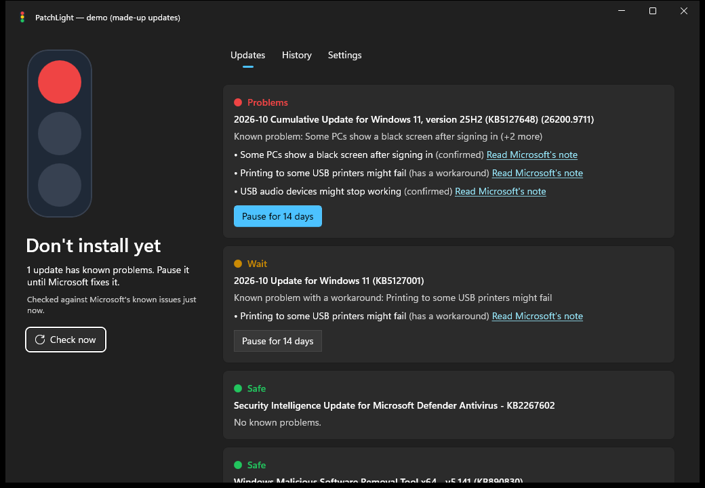

<p align="center"></p>

# PatchLight 🟢🟡🔴

**Know if a Windows update is safe before you install it.**

Windows updates break PCs more often than they should: black screens, Remote Desktop
failures, broken audio. PatchLight checks every update waiting on your PC against
Microsoft's own list of known problems and gives it a light:

| Light | Meaning |
|---|---|
| 🟢 Safe | No known problems. |
| 🟡 Wait | A problem with a workaround, or it came out less than 3 days ago. |
| 🔴 Problems | Microsoft confirmed it breaks something. Pause it. |



*(Screenshot of demo mode with made-up updates. Run `PatchLight.exe --demo` to try it without touching anything.)*

## What it does

- **Traffic light in the tray.** The icon next to the clock is green, yellow or red, so you know at a glance.
- **Tells you when something is wrong.** A notification appears when an update waiting on your PC has known problems.
- **Pauses only the bad ones.** One click on **Pause** (Windows asks for permission) hides that update from Windows Update. Everything else keeps installing.
- **Never blocks forever.** A daily automatic check resumes a paused update as soon as Microsoft fixes it, and every pause ends after 14 days (you can choose up to 35), because security updates matter.
- **What broke my PC?** The History tab shows recent updates and marks the one most likely behind an open problem.

Windows 11 only. Free and open source. No account, no server, no tracking: your PC reads
Microsoft's public [Windows release health](https://learn.microsoft.com/en-us/windows/release-health/) pages directly.

## Get it

1. Download `PatchLight-win-x64.zip` from [Releases](https://github.com/yo-gabriel-portfolio-here/PatchLight/releases) and unzip it anywhere (for example `C:\Program Files\PatchLight`). Keep the folder together.
2. Run `PatchLight.exe`. It starts with Windows from then on and waits in the tray. You can turn that off in **Settings**.

If you move the folder later, open **Settings** and turn the daily check off and on again.

## Command line

There is also a single-file `patchlight.exe` for the terminal:

```
patchlight                       Check the updates waiting on this PC
patchlight hold KB5127648        Pause an update (needs administrator)
patchlight release KB5127648     Resume it
patchlight history               Which recent update likely broke something
```

## How it works

- **Lights:** each pending update is matched with the known issues on Microsoft's release health page for your Windows version. Cumulative updates inherit open problems from the builds they build on.
- **Pausing:** uses Windows Update's own "hide this update" switch, so nothing is uninstalled or blocked outside Windows Update.
- **Daily check:** a scheduled task (`\PatchLight\Daily check` in Task Scheduler) runs `PatchLight.exe --background-check` as SYSTEM once a day. Its data folder, `C:\ProgramData\PatchLight`, can only be changed by administrators.
- **Your settings:** `%LOCALAPPDATA%\PatchLight`.

### Uninstall

1. In PatchLight, open **Settings** and turn off **Daily automatic check** and **Start with Windows**.
2. Resume anything you paused, from the **Updates** tab.
3. Exit PatchLight from the tray icon, then delete its folder, `C:\ProgramData\PatchLight` and `%LOCALAPPDATA%\PatchLight`.

## Build

Requires the .NET 10 SDK on Windows 11. No Visual Studio needed.

```
dotnet test
dotnet run --project src/PatchLight.App -- --demo
dotnet run --project src/PatchLight.Cli
.\scripts\publish.ps1            # builds dist\PatchLight, dist\patchlight.exe and the zip
```

## License

MIT
